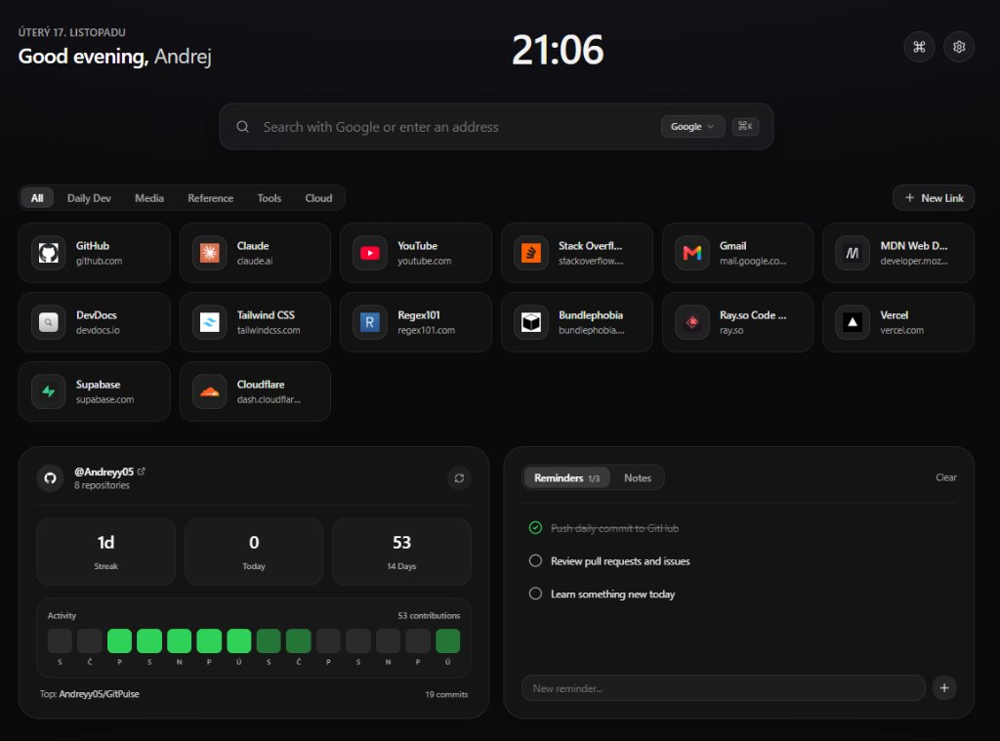

<div align="center">

# 🚀 DevTab

### *Minimalist, Apple-inspired Developer Startpage & New Tab Hub*

A serene, ultra-fast, and keyboard-first browser new tab experience designed for developers.<br/>
Keep your GitHub streak alive, launch workspaces in milliseconds, and manage daily priorities without distraction.

[](LICENSE)
[](https://react.dev/)
[](https://vite.dev/)
[](https://tailwindcss.com/)
[](https://andreyy05.github.io/devtab/)

<br />

<p align="center">
  
</p>

</div>

---

## 💡 The Philosophy

Modern browser new tab pages are cluttered with news feeds, clickbait, and heavy dashboards. **DevTab** takes the opposite approach:
- **Cupertino Restraint**: Clean typography, frosted glass materials (`backdrop-filter`), and deep obsidian canvas without sensory overload.
- **Zero AI Slop**: No fake inspirational quote feeds or noisy widgets — only real developer tools and live metrics.
- **100% Local-First & Private**: Your notes, reminders, and links stay in your browser's `localStorage`. No telemetry, no external databases, zero tracking.
- **Keyboard-Centric**: Built for developers who rarely take their hands off the keyboard.

---

## ✨ Features

### 🔍 Spotlight Omni-Search (`⌘K` or `/`)
- Instant search across **Google**, **GitHub**, **DuckDuckGo**, **Stack Overflow**, and **MDN Web Docs**.
- **Direct Address Execution**: Detects URLs and local environments (e.g. `localhost:3000`, `ray.so`, `docs.new`) and opens them immediately.
- Real-time matching filter across all your saved bookmarks.

### 📌 Launchpad Workspace & Squircles
- Organize bookmarks into folders: `Favorites`, `Development`, `Cloud`, `Utilities`, or your own custom categories.
- Automatic high-resolution favicon resolution with graceful fallback.
- Hover actions to quickly edit URLs or delete outdated links.

### 🐾 Cupertino GitHub Activity Widget
- Live integration with the public GitHub API for your handle (`@Andreyy05`).
- Tracks current **consecutive streak days**, **today's pushes**, and **14-day contribution rhythm**.
- Highlights your top active repository and includes a 1-click manual refresh button with automated rate-limit caching.

### 📝 Apple Reminders & Notes
- **Reminders**: Minimalist task checklist with satisfying strike-throughs and completion counter.
- **Notes**: Monospace scratchpad for quick code snippets, terminal commands, or JWT tokens with automatic persistent saving and 1-click clipboard copy.

### 🎨 System Preferences & Backup
- **5 Apple Accent Themes**: macOS Blue, Graphite, Mint, Purple, and Tangerine.
- **12h / 24h Clock Formats**: Real-time digital clock with localized date and dynamic greetings.
- **Full Data Portability**: Export and import your entire configuration (bookmarks, notes, reminders) in a clean JSON format.

---

## ⌨️ Keyboard Shortcuts

| Shortcut | Action |
| :--- | :--- |
| <kbd>⌘K</kbd> or <kbd>/</kbd> | Focus Spotlight Omni-Search |
| <kbd>Esc</kbd> | Dismiss search focus / Close modals |
| <kbd>S</kbd> | Open Preferences |
| <kbd>?</kbd> | Toggle Keyboard Shortcuts helper |
| <kbd>Enter</kbd> | Execute search or navigate to URL |

---

## 🛠️ Tech Stack

| Technology | Purpose |
| :--- | :--- |
| **React 19** | Modern UI components and reactive state |
| **Vite 8** | Ultra-fast build tool and developer server |
| **Tailwind CSS v4** | Modern utility-first styling with custom frosted glass design tokens |
| **Lucide Icons** | Crisp, lightweight icons |
| **GitHub Actions** | Automated CI/CD pipeline for instant GitHub Pages deployment |

---

## 🚀 Getting Started

### Prerequisites
- [Node.js](https://nodejs.org/) (v18 or higher recommended)
- [npm](https://www.npmjs.com/)

### 1. Clone & Install
```bash
git clone https://github.com/Andreyy05/devtab.git
cd devtab
npm install
```

### 2. Start Development Server
```bash
npm run dev
```
Open **[http://localhost:5173](http://localhost:5173)** in your browser.

### 3. Build for Production
```bash
npm run build
```
Compiled assets will be generated in `./dist`.

---

## 🧩 Install as Browser New Tab

### Option A: Load as Chrome / Edge Extension (Unpacked)
1. Run `npm run build`.
2. Open your browser and navigate to:
   - **Chrome**: `chrome://extensions/`
   - **Edge**: `edge://extensions/`
   - **Brave**: `brave://extensions/`
3. Toggle on **Developer mode** in the top right corner.
4. Click **Load unpacked** and select the `dist` folder.
5. Every new tab will now open DevTab instantly!

### Option B: Use with GitHub Pages URL
1. Enable GitHub Pages in your repo (**Settings** > **Pages** > **GitHub Actions**).
2. Install any lightweight new-tab redirect extension (e.g. *Custom New Tab URL*).
3. Set the target URL to:
   ```
   https://andreyy05.github.io/devtab/
   ```

---

## 🔒 Privacy & Local-First Architecture

DevTab does not collect any data:
- No tracking pixels or analytics scripts.
- No remote user accounts or authentication servers.
- All bookmarks, notes, reminders, and settings live strictly inside your local browser's `window.localStorage`.
- The only outbound network requests made are read-only fetches to the public GitHub API (`api.github.com`) to query public commit events.

---

## 📄 License

This project is licensed under the MIT License — see the [LICENSE](LICENSE) file for details.

Developed with ❤️ by [**Andrej Pavliščak**](https://github.com/Andreyy05).
